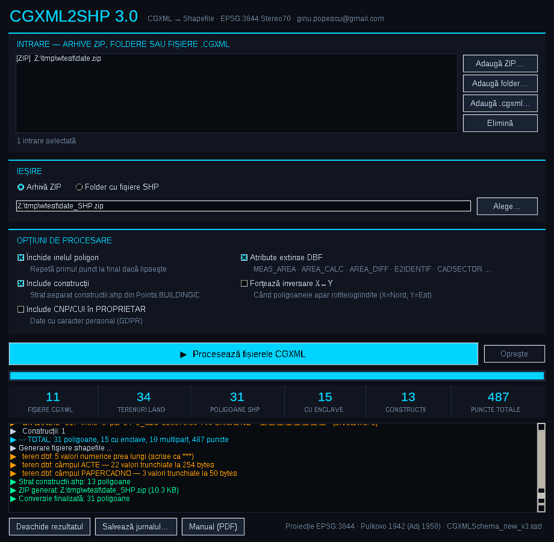

# CGXML2SHP 3.0 — aplicație Windows

Convertește fișierele cadastrale **CGXML** (schema `CGXMLSchema_new_v3.xsd`) în **shapefile** de poligoane,
în proiecția **Stereo70 (EPSG:3844)**. Recunoaște enclavele și terenurile din mai multe părți și completează
tabelul de atribute cu număr cadastral, acte, proprietari, categorii de folosință, arie măsurată și arie calculată.



## Descărcare

| Fișier | Ce este |
|---|---|
| [CGXML2SHP_3.0_Setup_win64.exe](dist/CGXML2SHP_3.0_Setup_win64.exe) | Kit de instalare — instalare pe utilizator, fără drepturi de administrator |
| [CGXML2SHP_3.0_portabil_win64.zip](dist/CGXML2SHP_3.0_portabil_win64.zip) | Versiune portabilă — se dezarhivează și se rulează, fără instalare |
| [CGXML2SHP_v3.0_Manual.pdf](docs/CGXML2SHP_v3.0_Manual.pdf) | Manualul de instalare și utilizare (română) |

Sumele de control SHA-256 sunt în [dist/SHA256SUMS.txt](dist/SHA256SUMS.txt).

**Cerințe:** Windows 10 sau 11, 64 de biți. Aplicația include propriul Python 3.12 — nu trebuie instalat
nimic altceva și nu are nevoie de internet.

Executabilele nu sunt semnate digital: la prima rulare Windows poate afișa *„Windows a protejat computerul”*.
Apăsați **Mai multe informații → Rulează oricum**.

## Ce face

- Interfață grafică și linie de comandă (`cgxml2shp-cli.cmd`) pentru procesări în lot
- Intrări multiple: arhive ZIP, foldere întregi (inclusiv subfoldere) și fișiere `.cgxml`
- Ieșire ca arhivă ZIP sau direct într-un folder: `teren.shp/.shx/.dbf/.prj/.cpg` și, opțional, `constructii.*`
- Enclave și terenuri multipart, cu inelele orientate conform specificației ESRI
- DBF în UTF-8 (diacriticele se păstrează), cu `MEAS_AREA`, `AREA_CALC`, `AREA_DIFF`, `ACTE`, `PROPRIETAR`, `CATFOLOS` etc.
- CNP/CUI în `PROPRIETAR` doar la cerere (date cu caracter personal)
- Logica de conversie este aceeași cu a versiunii web 2.1; rezultatele sunt identice pentru aceleași date

Detaliile complete sunt în [manual](docs/CGXML2SHP_v3.0_Manual.pdf).

## Linie de comandă — exemple

```
cgxml2shp-cli.cmd "D:\Cadastru\export.zip"
cgxml2shp-cli.cmd "D:\Cadastru\UAT_Comana" -o "D:\GIS\comana_teren.zip" --constructii
cgxml2shp-cli.cmd a.cgxml b.cgxml --folder -o "D:\GIS\rezultat"
cgxml2shp-cli.cmd --help
```

## Codul sursă

Aplicația folosește doar biblioteca standard Python (fără dependențe externe).

```
src/
  cgxml2shp/core.py   logica de conversie (CGXML → SHP/SHX/DBF/PRJ/CPG)
  cgxml2shp/gui.py    interfața grafică Tkinter
  cgxml2shp/cli.py    linia de comandă
  main.pyw, cli.py    punctele de pornire folosite de CGXML2SHP.exe și cgxml2shp-cli.cmd
  app.ico             pictograma
packaging/
  launcher.nsi        lansatorul CGXML2SHP.exe (NSIS)
  installer.nsi       kit-ul de instalare (NSIS)
tools/
  build.sh            construiește versiunea portabilă și kit-ul de instalare
  make_manual.py      generează manualul PDF (reportlab)
  make_icon.py        generează pictograma (Pillow)
```

### Rulare din sursă (orice sistem cu Python 3.8+ și Tkinter)

```
python src/main.pyw                         # interfața grafică
python src/cli.py date.zip --constructii    # linie de comandă
```

### Construirea pachetelor Windows

Pe Linux, cu `makensis` (NSIS 3) și Python 3 (`pip install reportlab pillow` pentru manual și pictogramă):

1. Dezarhivați Python Windows x64 *install_only* de la
   [python-build-standalone](https://github.com/astral-sh/python-build-standalone/releases)
   (folosit: `cpython-3.12.11+20250612-x86_64-pc-windows-msvc-install_only.tar.gz`) în `build/pyrt/`,
   astfel încât să existe `build/pyrt/python/python.exe`.
2. Generați manualul:
   `python3 tools/make_manual.py build/CGXML2SHP_v3.0_Manual.pdf tools/captura_gui.png src/app_512.png 3.0`
3. Rulați `tools/build.sh`. Rezultatele apar în `dist/`.

Versiunea se schimbă în `src/cgxml2shp/core.py` (`__version__`).

## Licență

Codul aplicației: GPL-2.0 (vezi [LICENSE](../LICENSE)). Python și Tcl/Tk incluse în pachetele Windows au propriile
licențe, aflate în `runtime\LICENSE.txt` după instalare.

Contact: ginu.popescu@gmail.com
